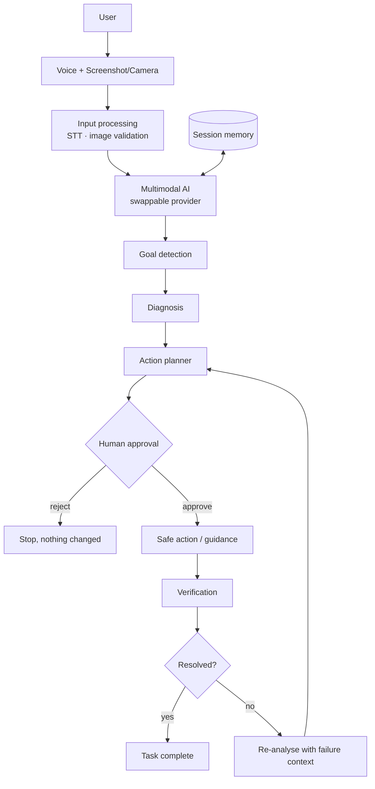

# ContextBridge

> **Real-time AI that hears you and sees your screen, for anyone stuck mid-task**
> *Understand. Diagnose. Guide. Verify.*

**Team Novyra · AI Build Challenge 2026 · PS-05: Real-Time Voice & Multimodal Agents**

## Problem statement
PS-05: build real-time voice and multimodal agents that understand what a user says *and* what they are showing.

## Problem
When people get stuck on a digital task (most often debugging) they have to describe a screen in words, paste fragments into a chatbot, try an answer, and come back when it fails. Most voice/vision assistants stop at *"here's an answer"*, with no check that the problem was actually solved.

## Solution
ContextBridge combines the user's **voice request**, a **screenshot or camera image** and **session memory** to run a closed agent loop:

`goal → diagnosis → plan → human approval → safe action/guidance → verification → success or re-analysis`

## Differentiation
| Typical voice+vision chatbot | ContextBridge |
|---|---|
| Voice/screen → answer | Voice + screen → **goal, diagnosis, plan** |
| Suggests; user hopes it worked | **Explicit approval** before anything consequential |
| No follow-through | **Verifies the result**; if it failed, **re-analyses** and revises the plan |
| Stateless | **Session memory** ("Okay, I did that. What next?") |
| Overconfident | Confidence is stated; no invented highlights |

## Features
- Voice input (mic → Gemini transcription) with typed fallback; optional spoken replies (gTTS)
- Visual input: **image upload (always works)**, browser camera
- Structured diagnosis: goal, issue, location, cause, explanation, fix, plan, confidence, verification plan
- Agent states: READY · LISTENING · ANALYZING · PLANNING · WAITING FOR APPROVAL · ACTING · VERIFYING · RESOLVED · RE-ANALYZING · ERROR
- Human approval gate; safe action layer; real verification loop
- Explanation level: Beginner / Intermediate / Expert
- Visual guidance: highlight drawn **only** when a valid region is available
- Agent timeline, conversation history, clear session
- **Demo Mode** (offline, clearly labelled) with 3 scenarios
- Evaluation tab (log real cases, CSV export)

## Architecture

```mermaid
stateDiagram-v2
  [*] --> READY
  READY --> LISTENING
  READY --> ANALYZING
  LISTENING --> ANALYZING
  ANALYZING --> PLANNING --> WAITING_FOR_APPROVAL
  WAITING_FOR_APPROVAL --> ACTING: approve
  WAITING_FOR_APPROVAL --> READY: reject
  ACTING --> VERIFYING
  VERIFYING --> RESOLVED: success
  VERIFYING --> RE_ANALYZING: still failing
  RE_ANALYZING --> PLANNING
  ANALYZING --> ERROR
```

## Tech stack
Python · Streamlit · Google Gemini (`google-genai`) for multimodal reasoning + transcription · gTTS · Pillow · python-dotenv · pytest.
(OpenCV and FastAPI were deliberately not added; they aren't needed.)

## Installation
```bash
cd contextbridge
python -m venv .venv
source .venv/bin/activate        # Windows: .venv\Scripts\activate
pip install -r requirements.txt
cp .env.example .env             # Windows: copy .env.example .env
```

## Environment variables
| Variable | Purpose |
|---|---|
| `GEMINI_API_KEY` | Gemini key (https://aistudio.google.com/apikey). Never commit `.env`. |
| `GEMINI_MODEL` | Optional, default `gemini-2.5-flash` |
| `AI_TIMEOUT_SECONDS` | Optional, default `45` |

## Running locally
```bash
streamlit run app.py
```
Opens at http://localhost:8501. With no key it starts in **Demo Mode**.

## Demo mode
Sidebar → **Demo Mode**. Scripted, works offline, **labelled as Demo Mode everywhere and never presented as an AI result.**
Scenario 1 uses a real sandbox: approving applies a patch to `demo_workspace/app.py` and verification **really runs that file**. Toggle *"Simulate an incomplete first fix"* to show verify → fail → re-analyse → fix → pass.
Limits: demo can't transcribe audio (use the sample request) and doesn't analyse uploaded images.

## Live AI mode
Set `GEMINI_API_KEY`, choose **Live AI (Gemini)**. Upload a screenshot → Capture context → speak/type → **Analyze and guide**. After approval, ContextBridge *guides* you (it does not touch your files). Apply the change, upload a fresh screenshot and press **Verify result**; the model compares it with the diagnosis. If still broken it re-analyses with the failure in memory. If the model returns non-JSON, a plain-text answer is shown.

## Safety
- No shell execution of AI output, no package installs, no deletes, no arbitrary file access
- Only allow-listed action types; the sole file operation is a unique find/replace on `demo_workspace/app.py`
- Verification runs only that sandbox file with a fixed command (`python -I`, 5 s timeout)
- AI suggestions containing risky patterns (`rm -rf`, `sudo`, `pip install`, …) trigger a warning and are never executed
- Every consequential action needs explicit approval; secrets only via `.env`; no raw stack traces shown

## Evaluation
**Targets (not achieved results):** baseline ≈ 12 min per issue; goal < 2 min.
Use the **Evaluation** tab to log ~20 real debugging/support cases: time to resolution (prefilled from the session timer, editable), issue identified correctly, recommendation useful, verification succeeded. Summary and CSV export are computed only from what you log.

## Limitations
- No native desktop screen capture (upload/camera only); highlights depend on the model and may be imprecise or absent
- Pipeline is record → transcribe → analyse → speak, not streaming audio; gTTS needs internet
- Real file edits/verification exist only for the sandboxed demo file; in Live mode the user performs the change
- Live verification relies on the model reading a new screenshot and can answer "unclear"
- Session memory is in-process and cleared on reload; single user
- Not yet benchmarked: evaluation numbers are intentionally empty

## Future scope
Native desktop screen sharing · deeper IDE integration · multilingual voice · more application integrations · autonomous tool use with granular permissions · persistent preferences · richer visual overlays · enterprise deployment. *(None implemented today.)*

## Screenshots
Add after your first run: `docs/01-ready.png`, `docs/02-diagnosis.png`, `docs/03-approval.png`, `docs/04-resolved.png`, `docs/05-reanalysis.png`.

## Tests
`python -m pytest -q` (unit tests + a headless end-to-end Demo Mode run).

## Team Novyra
Built for AI Build Challenge 2026, PS-05.
